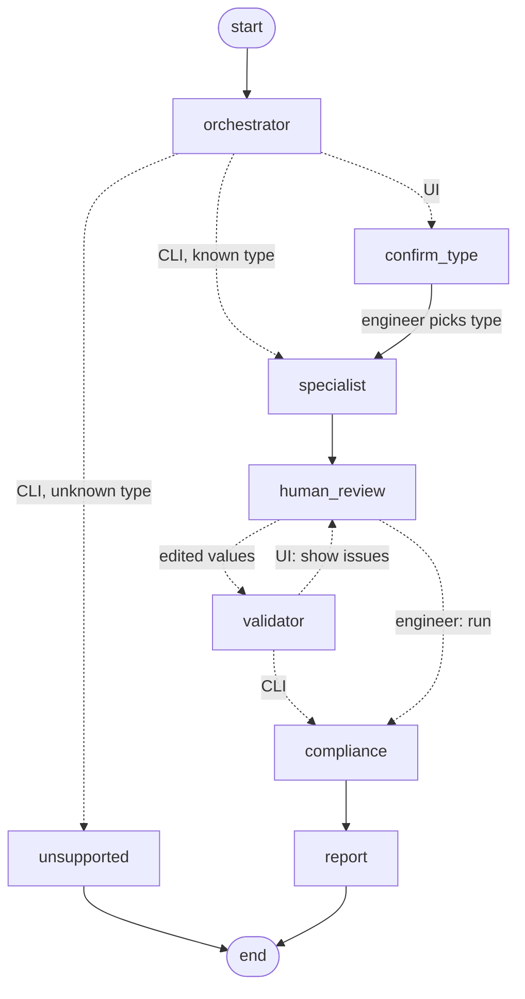

# Automated IS Code Compliance Checker for RCC Structural Drawings

Multi-agent RAG system that checks RCC structural drawings (**foundation, column, slab, beam**) against
**IS 456:2000** and **SP 34:1987**, with a human-in-the-loop verification step.

## Pipeline

```
PDF / image
  │  preprocess.py   PyMuPDF → images (200 DPI), PIL: RGB, longest side 800–2048 px, base64 data URLs
  ▼
Orchestrator         classifies foundation | column | slab | beam | unknown  (temperature 0, ~80 tokens)
  ▼
Specialist           vision model + type-specific schema (27–34 parameters). Each parameter:
                     {value, unit, source_location, status: found|missing|ambiguous, note, clarification}
                     Never invents values – missing/ambiguous items get a clarification question.
  ▼
Engineer (UI)        reviews / corrects every value in an editable table, can override the drawing type
  ▼
Validator            deterministic rules (units, grades, ly/lx, steel %, swapped values …)
                     + LLM internal-consistency pass. No RAG yet.
  ▼
RAG Compliance       one retrieval query per check (≈13 per drawing type), filtered by codebook,
                     BGE embeddings → ChromaDB → LLM verdict per check with clause + page.
                     Citation guard: verdicts citing passages not retrieved for that check are withheld.
  ▼
Report               markdown + PDF: summary, per-check table with clause/page, reasoning, validator
                     findings, verified parameters, missing/wrong information
```

### LangGraph orchestration (`src/graph.py`)

The agents run as a LangGraph `StateGraph` with a checkpointer. The engineer steps are `interrupt()`s:
the graph pauses at `confirm_type` and `human_review` and resumes with the engineer's input. Edited values loop
back through the Validator until the engineer releases them for the compliance check. The CLI runs the same
graph with `human: False` (no pauses; unknown drawing types end at `unsupported`).



## Knowledge base

| | |
|---|---|
| Sources | `kb_sources/IS456*.pdf`, `kb_sources/SP34*.pdf` (supply yourself – not committed), plus `SP34_md/` (SP 34 OCR + drawing-reading guides) |
| Content types | text (per page), tables (PyMuPDF `find_tables` → markdown), figures (optional Gemini descriptions) |
| Metadata | `source`, `doc`, `page`, `page_end`, `section`, `clause`, `clause_title`, `type`, `label` (e.g. `table 16`), `refs` |
| Chunking | `RecursiveCharacterTextSplitter`, 700 characters, 150 overlap, split at clause boundaries |
| Embeddings | `BAAI/bge-large-en-v1.5` (1024-d, normalised, BGE query instruction on queries) |
| Store | ChromaDB collection `is_codes_v2` (cosine), idempotent upserts with stable chunk ids |
| Deploy index | `kb_index/`: the same BGE-large vectors + every check query's vector, exported to numpy (`src/rag/index_store.py`) |
| Retrieval | metadata filter by codebook + expansion: tables/figures referenced by a hit (“see Table 16”) are pulled in |

Retrieval queries are fixed per compliance check, so their BGE-large vectors are precomputed at ingest time.
A deployment therefore needs only numpy: no torch, no embedding model, no Chroma (`VECTOR_BACKEND=auto`
picks `kb_index/` when those are not installed). After changing a check query, re-run
`python -m src.rag.index_store`.

## Setup

```bash
python -m venv .venv
.venv\Scripts\activate            # macOS/Linux: source .venv/bin/activate
pip install -r requirements.txt                       # runtime: enough to run the app on kb_index/
pip install -r requirements-kb.txt                    # KB build + tests (torch, BGE, Chroma)
copy .env.example .env            # then set the API keys
```

Build the knowledge base (downloads the BGE model on first run, ~1.3 GB; also re-exports `kb_index/`):

```bash
# optional but recommended: put IS456.pdf and SP34.pdf in kb_sources/
python -m src.rag.ingest --reset                     # text + tables
python -m src.rag.ingest --reset --describe-figures  # also describe figures with Gemini (API cost)
```

Without `kb_sources/IS456*.pdf` the knowledge base contains only SP 34 + guides, and IS 456 checks will
mostly come back as *Insufficient Data* (by design – the agent does not cite from memory).

## Run

```bash
streamlit run final.py                       # UI with human verification
python app.py sample_pdfs/7.pdf --json out.json   # CLI, no human step
python app.py drawing.pdf --type beam        # skip classification
```

## Deploy (Streamlit Community Cloud)

1. share.streamlit.io → **Create app** → this repo, branch `main`, main file `final.py`.
2. Advanced settings → Python 3.12, and paste the `.env` values as secrets (TOML, e.g. `LLM_BASE_URL = "..."`);
   top-level secrets are exposed as environment variables, which `src/config.py` reads.
3. Deploy. Only `requirements.txt` is installed; retrieval runs on the committed `kb_index/`.

## Tests

```bash
pytest -q                     # unit tests, no API key / model download needed
RUN_RECALL=1 pytest -q -k recall   # retrieval recall on the real KB (needs IS 456 ingested)
```

## Layout

```
src/
  config.py            env-driven settings (models, limits, RAG params)
  llm.py               OpenRouter client, JSON-mode helper
  preprocess.py        PDF → images, PIL limits, data URLs
  units.py             parsers: M25, Fe500, 4-16 dia, T10@150, 50d, 230x450 …
  schemas/             ParamSpec lists per drawing type + pydantic Extraction models
  agents/
    orchestrator.py    classification
    specialist.py      schema extraction
    validator.py       rule + LLM consistency checks, derived values
    checks.py          compliance check registry (params + retrieval query per check)
    compliance.py      per-check RAG, LLM verdicts, citation guard
  rag/
    ingest.py          codebook → chunks with metadata → Chroma
    embeddings.py      BGE wrapper
    retriever.py       filtered search + reference expansion
  graph.py             LangGraph state graph: agent nodes, routing, human-in-the-loop interrupts
  pipeline.py          stage functions (graph nodes call these)
  report.py            markdown report + PDF export
final.py               Streamlit UI
app.py                 CLI
tests/
```

## Environment variables

See `.env.example`. Only `OPENROUTER_API_KEY` is required; each agent's model can be overridden
(`ORCHESTRATOR_MODEL`, `SPECIALIST_MODEL`, `VALIDATOR_MODEL`, `COMPLIANCE_MODEL`, `FIGURE_MODEL`).
